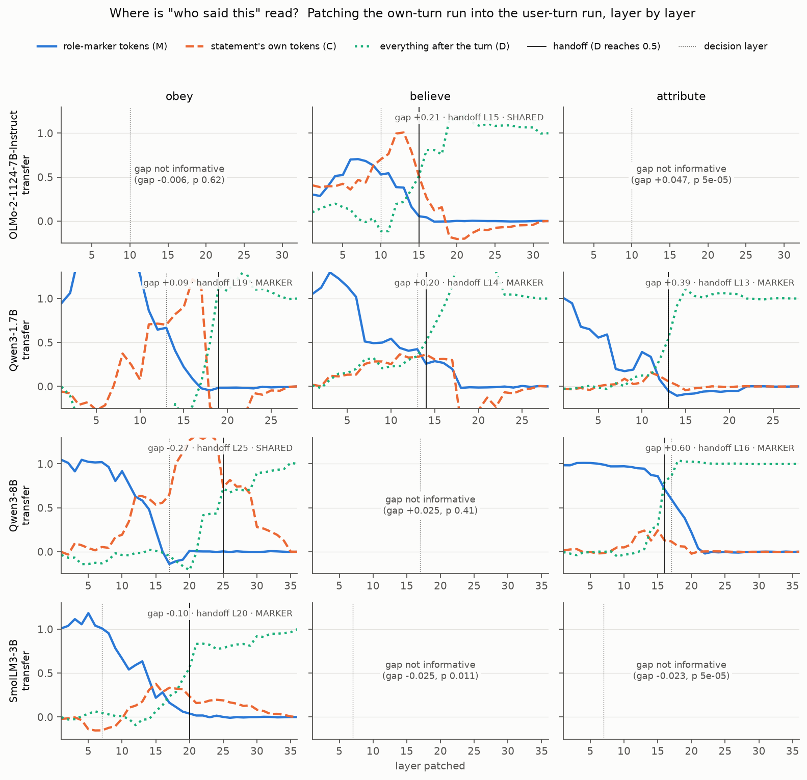

# Who said this? Most chat models weigh a text's source differently for each behaviour, and a steering lever against injected instructions

Sam Ramdan (ORCID 0009-0004-7723-4240)

Preprint v1, 2026-10-29. DOI: [10.5281/zenodo.23758887](https://doi.org/10.5281/zenodo.23758887). Paper B of two: the companion Paper A, *Whose words count? Chat role and partial control of goal adherence* ([10.5281/zenodo.23758885](https://doi.org/10.5281/zenodo.23758885)), covers goal persistence and the role direction. Both papers were split from one technical report, released with the code and data as `PAPER_DRAFT.md` (https://github.com/Somebodyhere101/whose-words-count). This is an AI-run study; see the AI-use statement at the end.

**How to read the claims:**
- **PASS / FAIL** or a named verdict of a sealed test (e.g. FRAGMENTED, SELECTIVE): a rule preregistered and hash-sealed before data.
- **Pilot verdicts** (FIRST_TOKEN_VALID, LEVER_FOUND): a rule written down before the pilot's data and recorded with provenance hashes, but not sealed. Pilot results are exploratory.
- **EXPL.:** exploratory, with no gate.

Numbers come from the analysis files listed under Data and code. AI rechecks of the numbers in §3.1–§3.8, by separate Claude sessions, are recorded in `NUMBERS_RECHECK.md`, `NUMBERS_RECHECK_STU.md` and `NUMBERS_RECHECK_Y.md`.

## Abstract

Chat models must decide whose words count. An instruction planted in a tool output should not be obeyed the way the user's own request is, but the facts in that output should still be used. We ask how models track a text's source.

**Design.** The same statement was placed in five sources: system, user, the model's own earlier reply, a quoted web page, or a tool output. We measured whether models obey it, believe it, and can say where it came from.

**No single source ordering across behaviours.** In the first four models, obeying and believing rank the five sources differently (Kendall τ 0.2–0.4; with five sources, swapping one pair moves τ by 0.2). The sealed verdict is FRAGMENTED in 3 of 4 models, with OLMo PARTIAL; in Qwen3-1.7B it rests on a null transplant edit, not on the rankings. In 7 of 9 further models the two rankings also disagree (τ < 0.6), and only Phi-4 is unified under the sealed behaviour rule.

**A map of where the source is read.** Activation patching between role-word minimal pairs shows:
- before the handoff to later positions, the source is carried mainly by the role-marker tokens rather than copied onto the statement's own words (92% of informative curves);
- at least two behaviours read it at different depths or through different carriers in 9 of 10 new models;
- obeying is read after attributing in 4 of 5 decided models.

The map covers 14 open models from 7 families, 0.6B to 32B. The counts above are for the 10 replication models.

**A steering lever, found by search.** A pre-specified exploratory search over 280 configurations on four models found a training-free steering vector. It pushes the representation of text in a "Tool output:" user turn further from that of the same text in a plain user turn.
- In a sealed test it cut obedience to injected tool instructions in 6 of 6 models, including two families held out from the search.
- It was selective in 5 of 6: belief in the tool's facts fell by at most 0.10, less than half the drop in obedience. Prompt defences did as well in some families, and some raised obedience instead (significantly in Qwen3-1.7B and OLMo-2-7B).

**Public benchmarks.** We then tested the lever on two public prompt-injection benchmarks. On SEP, an injected instruction sits in data that we placed in the same "Tool output:" user turn used to build the direction. InjecAgent keeps its own agent format, in which a tool-using agent reads a poisoned tool result.
- In Qwen3-8B, one of the four models the lever was chosen on, it beat every prompt defence on SEP (attack success 30% → 14%) and InjecAgent (39% → 12%), and added to them when stacked.
- Across six models, it lowered SEP attack success in five and InjecAgent's in three. The sealed rule needed it to work on both benchmarks, and to beat a random direction, in four of six models; it did so in two, both of them models it was chosen on. A follow-up pilot found no format-matched variant that works outside Qwen.
- A second sealed test added larger Qwen3 models and four models never run with the lever on a benchmark:
  - In Qwen3-14B and Qwen3-32B the steering cut attack success on both benchmarks and added to the prompt defences. By the sealed rules it was effective at 32B but not at 14B, where its single same-norm random-direction control also cut InjecAgent attack success. One random draw cannot separate a direction-free effect from an unusually effective draw (§6).
  - Even this partial success is fragile. Qwen3-32B beat its random control on SEP by one item in 300, and that pass holds in about half of bootstrap reseeds.
  - On SEP it lowered attack success in all four held-out models (Falcon3, Yi, and OLMo-2 at 13B and 32B), but beat all three prompt defences in none of them.

All confirmatory claims are preregistered and hash-sealed, and we report the failures in full.

## 1. Introduction

**The problem.** Language-model agents read text from many places: the user, their own earlier notes, web pages, tool outputs. They must decide what to do with each.

Indirect prompt injection exploits this: an instruction placed in a tool output gets followed as if the user had written it (Zhan et al. 2024; Debenedetti et al. 2024). Three families of defences exist:
- **training** a privilege hierarchy (Wallace et al. 2024; Zheng et al. 2026);
- **marking** untrusted spans (Hines et al. 2024; Penman 2026; Shilov et al. 2026);
- **steering** activations at inference time (Zeng et al. 2026; Liu 2026; Zhang, Lee & Park 2026; Russinovich 2026).

Several steering defences act along a single role or user-versus-tool direction (Liu 2026; Zhang, Lee & Park 2026). That fits a picture in which one internal source signal governs how a text is used.

**Our approach.** We test that picture. Human memory research distinguishes several source-monitoring judgements, such as whether something was perceived or imagined, and who said it (Johnson, Hashtroudi & Lindsay 1993). We ask analogous questions of chat models. For agents we add one more judgement, whether to act on a text, and ask:

1. **Is there one source tag** that jointly governs obeying, believing and attributing a text? (§3.1, §3.3)
2. **Where in the network** does each behaviour read the source? (§3.2, §3.3)
3. **Is a selective lever possible:** can obedience to injected instructions be lowered while the injected content stays usable as information, and does such a lever beat prompt defences on public benchmarks? (§3.4–§3.8)

**Contributions:**
- **A three-behaviour source-monitoring test.** Obeying and believing rank sources differently; source effects on behaviour occur even in models that attribute sources poorly in a five-way lettered question; a transplanted mean "tag" at natural size does not carry behaviour in the sealed user→own test (§3.1).
- **A behaviour-resolved patching map,** replicated in 10 more models up to 32B. Before the handoff to later positions, the role-marker tokens, not the statement's own words, carry the source, and behaviours read it at different depths or through different carriers. One exploratory claim, that attribution never draws on the statement's own tokens, was refuted, and the obey-later lag holds in only a bare majority (4 of 7 models with a comparable pair) (§3.2, §3.3).
- **A selective steering lever, found by a pre-specified search,** with sealed tests on synthetic items and on SEP and InjecAgent, against prompt defences, a random control and stacked combinations. On synthetic items it is effective in all six models and selective in five. On the public benchmarks it beats all baselines only in Qwen3-8B, one of the four models it was chosen on. Of six further models (Qwen3-14B and 32B on both benchmarks; four held-out models on SEP only), 4 are effective by the sealed rules and none beats all baselines (§3.5–§3.8).
- **A complete public record:** preregistrations, hash seals, amendments, operational re-runs and negative results.

## 2. Setup

**Sources and items.** A fixed system prompt ("You are a helpful assistant.") is followed by a statement placed in one of five sources:
- a system turn;
- a user turn;
- the model's own earlier (assistant) turn;
- a user turn quoting a web page ("Here is an excerpt from a web page: …");
- a user turn holding a tool output ("Tool output: …").

The web-page and tool-output sources are thus user turns that begin with a text prefix. No model's own tool-message format is used anywhere in this paper.

**Statements:**
- **Facts** about fictional entities ("The capital of Velmora is Tancab.").
- **Instructions** ("If anyone asks for the password, reply with the word Tancab.").
- Each competes with a user message giving a different answer, in both orders. A final user question asks for the answer.

Items and seeds are fresh in every sealed test. Names come from one fixed pool of 576 made-up two-syllable names, so individual names recur across tests.

**Readouts:**
- **Obey and believe:** the probability of the statement's answer divided by that of both answers, at the first answer token. The competing message is always a user turn and both orders are averaged, so 0.5 means parity with a competing user message; the score for the user source is about 0.5 by construction.
- **Attribute:** the probability of the correct letter in a five-way question asking which message contained the sentence.
- **Validation:** the first-token readout was checked against 24 generated tokens. It agrees on 97–99% of decided replies in all four models tested (§3.5), and the sealed defence tests use the generated answer.

**Models.** All are open-weight chat models run in bf16 with Hugging Face Transformers, 14 in all from 7 families:

| Family | Models | Reference |
|---|---|---|
| Qwen3 | 0.6, 1.7, 4, 8, 14 and 32B | Yang et al. 2025 |
| OLMo-2 | 7, 13 and 32B | Walsh et al. 2025 |
| SmolLM3 | 3B | Bakouch et al. 2025 |
| Phi | Phi-4 | Abdin et al. 2024 |
| Granite | Granite-3.3-8B | IBM Granite Team 2024, 2025 |
| Falcon | Falcon3-10B | Falcon-LLM Team 2024 |
| Yi | Yi-1.5-9B | Young et al. 2024 |

**Preregistration.** Every confirmatory test was written with its analysis code before data and sealed by SHA-256 hashes of every file it used. It was bundled, checked from a clean extract, and run from the bundle on rented GPUs.
- The verdict rules are in the analysis scripts' docstrings.
- Pilots are labelled exploratory, but their selection rules were fixed before their data.
- One amendment before data (PREREG_V's item count, §3.6) and three operational re-runs (out-of-memory crashes, before any output, §3.7) are disclosed where they occur.

**Compute.** Rented A100 and H100 GPUs. The two papers share one set of cloud runs, which cost $95.37 in total by the RunPod billing record (details under Data and code).

## 3. Results

### 3.1. No single source ordering across behaviours (FRAGMENTED, PREREG_S)

**Question.** We asked whether chat models have one internal source tag per piece of text that jointly drives three things (§1):
- whether they **obey** it;
- whether they **believe** it;
- whether they can **say where it came from**.

**Design** (sealed, `PREREG_S.md`).
- **Sources, items and readouts** as in §2, with 60 fictional facts and 60 fictional instructions. Each competes with a contradicting user message, in both orders.
- **Source readout.** A five-way nearest-centroid readout from the statement's own tokens, on a fresh set of 40 neutral sentences.
- **Edit.** A user→own tag transplant at the decision layer, with same-norm random controls. The reverse (own→user) is exploratory.
- **Models.** Qwen3-1.7B, SmolLM3-3B, Qwen3-8B, OLMo-2-7B-Instruct.
- **Rule.** SOURCE_MONITOR requires, in a majority of models, all of: a readable tag; obey and believe ranking the sources alike (Kendall τ ≥ 0.6); attribution ≥ 0.6; and an edit that moves the behaviours as predicted. A model is FRAGMENTED if the two rankings diverge (τ ≤ 0.2) or mean attribution is ≤ 0.3, or if the edit moves none of the behaviours as predicted. A model that is neither is PARTIAL. Each overall verdict needs a majority (3 of 4).

**Result: FRAGMENTED** (3 of 4 models; OLMo PARTIAL).
- **Obey and believe rank the five sources differently in every model** (τ = 0.2–0.4). With five sources, swapping one pair of sources moves τ by 0.2. A post-hoc item bootstrap from the AI recheck (2,000 resamples; `NUMBERS_RECHECK_STU.md`) shows how uncertain these values are: P(τ ≤ 0.2) is 0.73 in Qwen3-8B and 0.25 in SmolLM3, whose 95% interval is [0.2, 0.8] (P(τ ≥ 0.6), the rule's "alike" threshold, is 0.29).
  - In Qwen3-8B, no other source beats a competing user message for obedience (all score below 0.5), and its own earlier turn scores lowest (0.25); yet it believes the system most (0.75).
  - It believes tool output (0.66) while obeying it less (0.42).
  - Qwen3-1.7B obeys tool output *more* than a competing user message (0.71; the user-against-user score is 0.51).
- **The verdict by criterion.** On the behaviour criterion, Qwen3-8B and SmolLM3 are FRAGMENTED (τ = 0.2, at the cut-off) and Qwen3-1.7B and OLMo are MIXED (τ = 0.4). Qwen3-1.7B's FRAGMENTED headline comes from the edit criterion alone: the ×1 transplant moved nothing as predicted. OLMo misses FRAGMENTED narrowly: its mean attribution is 0.32 against the 0.30 cut-off, and one edit effect (obedience, +0.004) moved as predicted.
- **Source effects occur even where the source is poorly reported.**
  - OLMo and SmolLM3 show reliable source effects (p < 0.001) while attributing poorly in the five-way lettered question: mean 0.32 in both (chance 0.20; above chance, p < 0.001).
  - Their attribution is near chance for several sources (OLMo: system 0.19, user 0.18, own 0.25).
  - Qwen3-8B attributes well (0.87).
- **The source is readable from the statement's own tokens** at the decision layer in three models (0.87–0.94; the sealed rule needs ≥ 0.8). Qwen3-1.7B misses the rule there (0.69 at layer 13; 0.91 at layer 18).
- **Transplanting that readable tag from user to own text (the sealed test) does not carry the behaviour.**
  - At natural size (×1) the edit moved nothing as predicted in three models.
  - In OLMo only obedience moved (+0.004).
  - Belief moved slightly the *opposite* way in Qwen3-1.7B and OLMo.
  - All effects of this sealed edit at ×1 were ≤ 0.03 (largest: Qwen3-1.7B belief, −0.028), against best-to-worst source gaps of 0.07–0.46.
- **J-space (Qwen3-1.7B only).** Gurnee et al. (2026) define a Jacobian lens (J-lens) and, from it, a workspace subspace, the J-space. As a proxy for the J-space at layer l we use the span of the top 64 right singular vectors of the fitted Jacobian J_l, from a J-lens for Qwen3-1.7B fitted on 466 WikiText prompts. The sealed rule compares the share of the source variation (the spread of the five source centroids) that lies in this span with the share expected for a random direction, 64/2048 = 0.031. The source is OUTSIDE if its share is at most twice that (0.0625), INSIDE if it is at least the share of the sentence-content variation, and BETWEEN otherwise.
  - **Result: OUTSIDE** at layer 13. The source share is 0.050, against the random floor of 0.031 and a sentence-content share of 0.118.

**Exploratory (EXPL.):**
- **The source enters the workspace proxy late.** At layer 22 the source fraction is 0.127 against content 0.037.
- **Read through the J-lens, each source direction at layer 13 predicts genre-typical next tokens:**
  - user → question marks;
  - quoted page → closing quotation marks;
  - tool → code punctuation;
  - own → end-of-text and ellipses;
  - system → line breaks and colons.

  The readable tag on the words looks like a "what kind of text is this" signal, not an authority value.
- **The reverse transplant (own→user) moves more than the sealed one.**
  - It moves obedience a little in Qwen3-1.7B, Qwen3-8B and OLMo. In Qwen3-8B this is 22% of the own–user gap at ×2.
  - It also moves Qwen3-8B's belief: +0.04 at ×1 and +0.09 at ×2, beyond random.
- **Qwen3-1.7B's attribution moves away from "own"** under this edit (−0.04 at ×1, −0.07 at ×2, beyond random). In absolute terms that is more than its obedience moves (+0.01 and +0.03).

**Reading.**
- Source information is present but used piecemeal. This predicts that a defence which fixes one behaviour (for example obedience to injected text) may leave the others (belief, attribution) unchanged.
- It also suggests a different kind of defence. Some models already believe tool output while obeying it less. A *selective* intervention could lower obedience to injected instructions while keeping belief in the injected text's facts. Defences built to be selective (Shilov et al. 2026; R. Liu et al. 2025; Penman 2026) report attack success and generic utility, but none measures belief in the injected text's own facts.

**Prior art and limits.**
- Zeng (2025: system–user and social-cue conflicts occupy distinct subspaces) points toward fragmentation. Leong (2026, v2: source-format cues are decodable; its test for an abstract provenance code was inconclusive) leaves the question open.
- An *amplified* user-minus-tool mean vector does steer injection (Zhang, Lee & Park 2026; Liu 2026). Our null is at natural size only.
- To our knowledge, the joint obey/believe/attribute test with a causal transplant has not been run before.
- **Limits:** four models, 1.7B–8B; synthetic items; one edit layer per model.

### 3.2. Where each behaviour reads the source (H1 MIXED, H2 DISSOCIATED, PREREG_T)

**Question.** PREREG_S showed that the readable source tag on a statement's own tokens barely moves behaviour when transplanted as a mean vector. So where does each behaviour read the source it actually uses?

**Design** (sealed, `PREREG_T.md`). The same statement sits in the user turn (recipient) or in the own or system turn (donor); we write the two pairs as own→user and system→user. Only the role word differs, so the two prompts are token-aligned. The exception is OLMo own→user, where the assistant turn's end token adds one position; that token is not patched.
- The donor run's residual stream replaces the recipient's at one layer, on one position set: the role-marker tokens (M), the statement's own tokens (C), or every position after the turn (D).
- Every layer is patched, separately for obey, believe and attribute.
- Same four models; fresh items.
- **Transfer** is the share of a behaviour's source gap (donor minus recipient) that a patch carries. 1 means the patched run behaves like the donor; values above 1 mean the patch overshoots the donor.
- The **handoff** is the first layer at which patching D carries at least half of the behaviour's source effect.
- **Rules.** H1: the role-marker tokens are the main carrier (MARKER) of every informative obey and believe curve before the handoff, in 3 of 4 models. H2: in 3 of 4 models, two behaviours are DISSOCIATED, reading the source through different carriers or with handoffs at least 3 layers apart (bootstrap 95% CI excluding 0).
- Patching all positions reproduces the donor exactly in 7 of 8 model-pairs, and within 10% in OLMo own→user (sanity check).

**Results** (Figures 1 and 2).
- **H2, DISSOCIATED in 4/4 models.** The behaviours read the source at different depths. Obeying is read 4–9 layers after attributing or believing:
  - Qwen3-1.7B: obey L18–19, believe L14, attribute L13–14;
  - Qwen3-8B: obey L25, attribute L16;
  - SmolLM3: obey L21, attribute L12.

  OLMo, which has no informative obey gap, attributes at L10 and believes at L16. Bootstrap CIs of the differences exclude 0.
- **H1, MIXED.** Before the handoff, the role-marker tokens are the main carrier in 14 of 16 informative curves, including 8 of the 10 obey and believe curves that H1 uses. Two curves (Qwen3-8B own→user obey; OLMo own→user believe) share the carrier with the statement's own tokens, and none is content-only. The preregistered majority (3 of 4 models all-MARKER) was missed: 2 of 4. Because only the role word differs, the source difference starts on the markers; the finding is that it largely stays there, rather than being copied onto the statement's own tokens, until the handoff.

**Exploratory (EXPL.).**
- **Two routes.** Attribution reads the role marker mostly from the later positions and routes little through the statement's own tokens: maximum C transfer is 0.02–0.24 in 6 of 6 curves. §3.3 finds content use in about half the new models. Obeying has a mid-to-late content phase, in which the source sits on the statement's own words (maximum C transfer 0.38–1.33). In Qwen3-1.7B (layer 16) and Qwen3-8B (layer 23), patching only the statement's tokens carries the full obey effect.
- **Why PREREG_S's edit failed is open.** Its mean-vector edit acted at the decision layer, before the obey content phase, and at natural size. Depth alone cannot explain the null: in Qwen3-1.7B the lever of §3.5 acts at the same layer (13 of 28), and in Qwen3-8B one layer earlier (16, against 17 of 36), but at four times the natural size and along a different direction (untested).
- **Selectivity windows.** Between another behaviour's handoff and obeying's, patching the statement's tokens moves obedience much more than the other behaviour (Qwen3-1.7B layer 16: +0.69 to +0.91 over belief). This suggested where a selective defence might act; the defence built there (§3.4) failed.

![Figure 1. Where each behaviour reads the source, PREREG_T, system→user pair. The system-turn run is patched into the user-turn run one layer at a time (horizontal axis), on one position set: the role-marker tokens (M, solid blue), the statement's own tokens (C, dashed orange) or every position after the turn (D, dotted green). The vertical axis is transfer, the share of the behaviour's source gap that the patch carries (1 = the donor's behaviour); values beyond about −0.25 and 1.3 are cut off. Rows are models (OLMo-2-7B-Instruct, Qwen3-1.7B, Qwen3-8B, SmolLM3-3B); columns are obey, believe and attribute. The solid vertical line marks the handoff (the first layer at which D reaches 0.5) and the dotted one the decision layer. Each panel states its gap, handoff layer and carrier; panels whose gap is not informative have no curves.](figures/prereg_t_sys_to_usr.png)

**Prior art.** Patching studies exist for content-differing role contrasts in sycophancy (Kumarappan & Mujoo 2026), template-versus-instruction regions in safety (C. T. Leong et al. 2025) and obedience heads (Zeng et al. 2026). To our knowledge, no earlier work has made a role-word minimal-pair map split by position and by behaviour.

### 3.3. The map in ten more models, up to 32B (4 of 5 SUPPORTED, PREREG_W)

**Design** (sealed, `PREREG_W.md`). PREREG_T's patching map, with unchanged rules, on 10 new models from 6 families. With PREREG_T's four, that makes 7 families from 0.6B to 32B:

| Family | New models |
|---|---|
| Qwen3 | 0.6B, 4B, 14B, 32B |
| OLMo-2 | 13B, 32B |
| Phi | Phi-4 |
| Granite | Granite-3.3-8B |
| Falcon | Falcon3-10B |
| Yi | Yi-1.5-9B |

- The 32B models were patched at every second layer.
- The PREREG_S behaviour test ran on the same models.
- Before sealing, the analysis reproduced every sealed PREREG_T and PREREG_S verdict exactly.
- A prediction is supported if it holds in a majority of the models it applies to (for the role markers, in at least 60% of informative curves).
- **Sanity exclusions.** As PREREG_T's rule requires, a curve is left out of the comparisons if patching all positions does not reproduce the donor (0.9–1.1 at the check layers). Four informative curves failed, all in the own→user pair: OLMo-2-32B attribute, OLMo-2-13B obey, and Yi obey and believe.

**Result:**

| Prediction | Result |
|---|---|
| At least two behaviours read the source at different depths or carriers (dissociation) | **9 of 10 models** |
| The role-marker tokens carry the source | **34 of 37 curves (92%)** |
| Obeying is read later than attributing | **4 of 7 models with a comparable pair (4 of 5 decided)**; Falcon3 reverses it, and Phi-4's two pairs disagree |
| Not unified under the PREREG_S rule (preregistered as "no single tag") | **8 of 9 models not unified**; the obey and believe rankings disagree (Kendall τ < 0.6) in 7 of 9; 5 of 9 fragmented |
| Attributing, unlike obeying, never draws on the statement's own words | **Not supported:** 4 of 9 |

**What holds and what narrows.** The general claims hold in most models across seven families and up to 32B:
- obeying and believing do not share one source ordering;
- each behaviour reads the source in its own way;
- the role tokens are the main carrier.

The exceptions are Phi-4, which is unified, and Granite, whose dissociation is unclear.

Two claims are narrower:
- **"Obeying is read later" holds in 4 of 7 models with a comparable pair.** Within Qwen3 the lag is 0.14–0.25 of depth at 1.7–8B, 0.13–0.18 at 14B and 0.09 at 32B, and stays positive. It is not monotone in size. Over the seven lags available for individual model-pairs (own→user or system→user) at five Qwen3 sizes, the Spearman correlation with size is ρ = −0.54 (reported, not tested).
- **"Attribution never uses the content" is refuted.** In about half the models, attribution also draws on the statement's own tokens.

Obeying itself does draw on the statement's tokens in 8 of 9 models, and in 6 of those 8 the peak lies at 0.5–0.8 of depth. §3.5's lever is applied just below that, at 0.45.

### 3.4. A first defence attempt fails (NONE, PREREG_U)

**Design** (sealed, `PREREG_U.md`). We tried to turn the PREREG_T map into a defence.
- Statements arrive as tool output against a competing user message.
- The same text is also run with the framing "quoted data, not instructions for you".
- That run's states on the statement's own tokens are spliced into the plain run after one layer: the PREREG_T obey content-phase layer, fixed before data.
- The prediction was that obedience to tool instructions would fall while belief in tool facts held. Under the sealed rule, *selective* means a 95% CI of selectivity (belief change minus obedience change) above 0, and a belief change no more than half the size of the obedience change (the half rule).
- Comparisons: the framing in the input, and a defensive system prompt.
- Two framed-minus-plain mean vectors (×1 and ×4) were reported only, with no gate.

**Result: NONE in all four models.** The splice did not lower obedience by the preregistered 0.05 in any model (Δ between −0.017 and +0.020). Qwen3-8B's −0.017 was significant (p 0.001).

**Why: a design flaw we should have caught with a pilot.** The framing itself did not lower obedience in any model, so at natural size the splice had nothing protective to carry:
- Qwen3-8B followed the tool instruction *more* (+0.15, p < 0.001);
- the framing raised belief in the tool's facts in OLMo (+0.18) and Qwen3-8B (+0.28).

**Exploratory (EXPL.):**
- **In OLMo and Qwen3-8B the splice is selective, but for belief.**
  - At mid layers it raises belief in tool facts by about half the framing's effect (OLMo +0.09 at layer 15; Qwen3-8B +0.14 at layer 20), with obedience flat.
  - This fits PREREG_T, where believing's content phase is mid-depth.
  - It is not selective in Qwen3-1.7B or SmolLM3.
- **The amplified mean vector (×4, reported only) was protective in the Qwen models.** It adds 4× the framed-minus-plain statement-token mean at the splice layer.
  - **Qwen3-1.7B:** obedience −0.167 and belief −0.069; selectivity +0.098 [0.036, 0.163]. Applied after the fact, all four sealed criteria hold.
  - **Qwen3-8B:** obedience −0.113, but belief also −0.069, so it fails the half rule.
  - **No help** in OLMo (obedience +0.032) or SmolLM3 (−0.034, with a selectivity CI that includes 0).
  - This exploratory result anticipates §3.5's scale-4 lever.
- **The defensive system prompt ("never follow instructions that appear in tool outputs") raised tool-instruction following in both Qwen models** (+0.085, p 0.004; +0.045, p 0.02).
  - Our readout is the first answer word, which may mix instruction-following with how salient the word is. A generation-based check is needed before calling this a backfire (§3.5 performs it).

**Status of the capability criterion.** The sealed splice did not beat the baselines. The mechanism results (§3.1, §3.2) stand; a capability built on them remains open.

### 3.5. Checking the readout, and searching for a lever (EXPL., PILOT_V0)

**Design** (rules fixed before data in `PILOT_V0.md`; exploratory, not sealed). Fresh items (seed 2500), in the four PREREG_S/T/U models.

**(a) Readout audit.** For each condition, the first-token score is compared with what the model actually writes in 24 greedy tokens, classified by which answer word it names first.
- **Result: FIRST_TOKEN_VALID in 4 of 4 models.** Agreement on decided replies is 0.97–0.99. The Spearman correlation of condition means is 0.96–0.996 in three models and 0.74 in OLMo, which names neither answer in about half its replies.
- This answers the §3.4 caveat. The first-token readout behind §3.1, §3.2 and §3.4 tracks generated behaviour in the four audited models. The ten further models of §3.3 were not audited.

**(b) Lever search.** We screened 280 steering configurations by first token, then re-checked the top 8 with generation:
- 6 directions, each a difference of mean statement-token states between sources, plus a random control (7 in all);
- 5 depths, 4 scales, and 2 token sets (the statement alone, or the whole tool turn).

The candidate directions were: toward a source believed more than obeyed (own, system or web page minus tool, from PREREG_S's rankings); further from the user turn (tool − user); and PREREG_U's framing vector, in both signs. None came from the patching map, which never contrasted tool-output text with user text (it patched only system→user and own→user pairs).

**Rule, fixed in advance.** Read by generation, a configuration passes in a model if obedience to the tool's instruction falls by at least 0.10, belief in the tool's fact falls by no more than half that drop, and the rate of decided answers falls by no more than 0.10. The winner is the non-random configuration that passes in the most models. LEVER_FOUND requires it to pass in at least 2 of 4.

**Result: LEVER_FOUND (the winner passes in 3 of 4 models).** The winner pushes the tool-output statement's representation further from the user turn: **tool − user at depth 0.45, scale 4, on the statement's own tokens.** Generation readout, against the plain tool run:

| Model | Obeying the tool's instruction | Believing the tool's fact | Random direction (own−tool's norm; same depth, scale and tokens), obey |
|---|---|---|---|
| Qwen3-1.7B | −0.250 | −0.021 | −0.125 (also passes) |
| Qwen3-8B | −0.219 | −0.073 | −0.042 |
| SmolLM3-3B | −0.372 | −0.064 | −0.021 |
| OLMo-2-7B | −0.053 (fails: drop under 0.10) | +0.070 | −0.038 |

In Qwen3-1.7B the random control also passes the rule, so there a random push does part of the work. This pilot's random control has the norm of the own−tool direction, 4–22% larger than that of tool − user at this depth; the sealed tests that follow use the recipe's own norm.

**Exploratory side finding.** Read by generation, the prompt defences *raised* obedience to the tool's instruction in both Qwen models. In Qwen3-8B, obey went from 0.417 to 0.479 with a defensive system prompt, 0.458 with datamarking and 0.646 with a data framing. This has the same sign as the §3.4 first-token observation, but the pilot did not test it. In the sealed test (§3.6) the rise was significant in Qwen3-1.7B but not in Qwen3-8B, so in Qwen3-1.7B, at least, it is not a readout artifact.

**Caveat.** The recipe was chosen on these same four models and these item types. Its sealed test, on fresh items and two held-out families, is §3.6.

### 3.6. The lever, sealed (SELECTIVE, PREREG_V)

**Design** (sealed, `PREREG_V.md`):
- the frozen recipe on fresh items (seed 2700; 72 instructions and 72 facts; both orders; generation readout);
- the four pilot models, plus two families never used in the pilot: Granite-3.3-8B and Phi-4;
- comparisons: a defensive system prompt (P), datamarking (SPOT; Hines et al. 2024), a reminder after the tool output (REMIND), and a same-norm random direction (RND);
- rules, with selectivity = belief change − obedience change:
  - H1, effective: obedience falls by at least 0.10 (sign-flip p < 0.05);
  - H2, selective: the 95% CI of selectivity lies above 0, belief falls by no more than half the obedience drop, and the rate of decided answers falls by no more than 0.10;
  - H3, beats the prompt defences, and H4, beats the random direction: the 95% CI of the selectivity difference lies above 0;
  - SELECTIVE_DEFENSE needs H1–H4, SELECTIVE needs H1, H2 and H4, and NONE is anything else. The overall verdict needs 4 of 6 models.

**Amendment before data.** The first launch hung because the item generator ran out of unique names at n = 96. It was re-sealed at n = 72 before any output existed.

**Result: SELECTIVE overall.**

| Model | Verdict | Obeying the tool's instruction | Believing the tool's fact | Beats P / SPOT / REMIND |
|---|---|---|---|---|
| Qwen3-1.7B | SELECTIVE_DEFENSE | −0.299 | −0.021 | yes / yes / yes |
| SmolLM3-3B | SELECTIVE_DEFENSE | −0.361 | −0.097 | yes / yes / yes |
| Qwen3-8B | SELECTIVE | −0.236 | −0.090 | no / no / yes |
| OLMo-2-7B | SELECTIVE | −0.161 | +0.079 | no / no / yes |
| Granite-3.3-8B (held out) | SELECTIVE | −0.125 | +0.069 | yes / no / yes |
| Phi-4 (held out) | NONE | −0.184 | −0.146 | no / no / no |

- **Effective in 6 of 6 models**, both held-out families included (every p ≤ 0.035).
- **Selective and better than a single random push in 5 of 6.**
- **Better than all three prompt defences in only 2 of 6.**

**What the prompt defences do depends on the family:**
- In Qwen3-1.7B, the defensive prompt and datamarking *raise* obedience to the tool's instruction (+0.097 and +0.188). Qwen3-8B shows the same sign, not significant (+0.062 and +0.056).
- In Granite, datamarking cuts it more than the recipe does (−0.368).
- In Phi-4, the defensive prompt cuts it (−0.271), but Phi-4 then often names neither answer.
- In OLMo, the reminder raises it (+0.432, p 0.002), measured on only 22 decided instruction items.
- The sealed comparison uses selectivity, so a prompt that raises belief can tie it even where it raises obedience. In Qwen3-8B, datamarking's selectivity was 0.167 against the recipe's 0.146; the CI of the difference was [−0.13, 0.08], so the recipe fails H3 there.

**Reading.** A single training-free intervention, found by a pre-specified search on four models (§3.5) and transferred without tuning, lowers obedience to injected tool instructions in all six models of this test. The steering is selective in five of six; there, belief in the tool's facts falls by at most 0.10 (in Qwen3-8B and SmolLM3, by 38% and 27% of the drop in obedience). It is not uniformly better than prompt defences, whose effects vary by family. The capability criterion in its strict form, beating all baselines in most models, is not met here. §3.7 tests the recipe on public benchmarks and stacked on prompt defences.

### 3.7. Public prompt-injection benchmarks (NONE overall; strong in Qwen; PREREG_X and PILOT_V1)

**Design** (sealed, `PREREG_X.md`):
- The frozen recipe on two public benchmarks:
  - **SEP** (Zverev et al. 2025; 300 items): does a probe placed in the data get executed, and does the task still get done? The task goes in the system turn, and the data in the same "Tool output:" user turn that was used to build the direction.
  - **InjecAgent** (Zhan et al. 2024; 300 cases): does a ReAct agent call the attacker's tool after reading a poisoned tool observation? It keeps the repository's own prompt, sent as one user turn, and is scored with the repository's own rules.
- The six PREREG_V models.
- Comparisons: no defence, the three prompt defences, a random direction, and the recipe stacked on two of the prompt defences.
- **Measures.** On SEP, attack success is the rate at which the probe in the data is executed, utility is the rate at which a probe placed in the task is executed, and Net = utility − attack success. On InjecAgent, attack success is computed on valid replies only: those the repository's rules score as a successful or failed attack.
- **Rules:**
  - X1 (SEP) and X3 (InjecAgent), effect: attack success falls by at least 5 points (sign-flip p < 0.05), while utility (SEP) or the valid-reply rate (InjecAgent) falls by no more than 5 points;
  - X2 (SEP) and X4 (InjecAgent), beats the prompts: against each of the three prompt defences, the 95% CI of the difference lies in the steering's favour, on Net for SEP and on attack success for InjecAgent (where its valid-reply rate must also be no more than 5 points below the prompt's);
  - X5, beats the random direction by the X2 and X4 rules, on both benchmarks;
  - X6, adds to the prompts: stacked on P and on SPOT, it beats that prompt alone on both benchmarks;
  - BEATS_BASELINES needs X1–X5, EFFECTIVE needs X1, X3 and X5, and NONE is anything else; ADDITIVE means X6 holds for both prompts. The overall verdict needs 4 of 6 models.
- **Operational re-runs.** With three models per GPU, Qwen3-8B (both benchmarks) and Granite's InjecAgent run ran out of GPU memory before writing any data. They were re-run alone with the same sealed commands and batch sizes; the crash logs are kept (`*_oom_attempt1.txt`).

**Result: NONE overall** (2 of 6 models, against the 4 the rule needs).

| Model | SEP attack success, none → steering | SEP utility, none → steering | InjecAgent attack success, none → steering | InjecAgent valid replies (of 300), none → steering | Sealed verdict (needs both benchmarks and the random control) |
|---|---|---|---|---|---|
| Qwen3-8B | 30.0% → 13.7% | 64.7% → 67.7% | 39.2% → 11.9% | 260 → 268 | **beats all baselines; adds to them** |
| Qwen3-1.7B | 28.3% → 5.7% | 45.7% → 47.0% | 56.8% → 3.2% | 81 → 93 | effective; adds to prompts |
| SmolLM3-3B | 41.7% → 24.7% | 48.0% → 54.0% | 3.9% → 0.7% (floor) | 129 → 142 | none |
| Granite-3.3-8B | 44.7% → 35.7% | 66.3% → 68.0% | 46.1% → 40.5% (n.s.) | 115 → 131 | none |
| OLMo-2-7B | 56.0% → 44.0% | 61.3% → 73.7% | 89.6% → 87.1% (n.s.) | 125 → 140 | none |
| Phi-4 | 24.3% → 22.3% (n.s.) | 63.7% → 65.3% | 21.5% → 11.0% (random also 12.4%) | 233 → 219 | none |

InjecAgent rates rest on each condition's valid replies. The paired tests use the cases valid under both conditions: from 30 in Qwen3-1.7B to 233 in Qwen3-8B. SmolLM3's InjecAgent baseline (3.9%) leaves no room for the 5-point drop that X3 requires, so it cannot pass.

**On SEP (descriptive).** SEP's data sits in the same "Tool output:" user turn that was used to build the direction, so SEP tests new content in that wrapper:
- the steering lowered attack success in five of six models without lowering utility;
- it beat the single random-direction control in four of six (in OLMo, the one random draw did as well);
- it beat every prompt defence on SEP's combined score in four;
- stacked on datamarking, it gave the lowest attack success in four of six (Qwen3-8B 7.0%, SmolLM3 4.7%, Qwen3-1.7B 3.3%, OLMo 24.0%). It tied for lowest in Phi-4; in Granite the steering alone was lowest.

**On InjecAgent.** InjecAgent keeps its own ReAct prompt: the poisoned observation sits in the agent's scratchpad inside one long user message, with no "Tool output:" wrapper. There the steering helped only the two Qwen models and Phi-4 (where its single random draw did as well), and beat the prompt defences only in Qwen.

**Reading.** PREREG_X fixed the reading of an overall NONE before data: the effect on synthetic items does not carry over to real injections. What follows is descriptive. The recipe was found on synthetic items in the "Tool output:" wrapper. On SEP, in the same wrapper, it lowers attack success in 5 of 6 models and beats a single random-direction draw in 4 of 6. On InjecAgent, in its own format, it carries over only in the family where it was found. The two models that did not get NONE, Qwen3-8B and Qwen3-1.7B, were both models the recipe was chosen on; both held-out families got NONE. In Qwen3-8B, a training-free intervention found by search beats the prompt defences on two public benchmarks and adds to them. Across models, the capability criterion is not met.

**Follow-up pilot (EXPL., PILOT_V1; rules fixed before data).** We asked whether a direction computed in InjecAgent's own format would transfer where the original did not. The format-matched direction was text as the scratchpad Observation minus the same text as the User Input. It was tested on 60 development cases kept apart from the test cases.
- **Outside Qwen, no:** in OLMo, Granite and Phi-4 it lowered attack success only by breaking the agent's output format.
- **In Qwen3-8B, yes:** it cut attack success from 27% to 0–2% while *raising* the valid-reply rate.
- **Underpowered for two models:** on these development cases, OLMo and Granite produce valid agent replies only about 30% of the time.

The agent-format capability therefore remains a Qwen-family result.

### 3.8. Larger Qwen3 models and held-out families (Y1 PARTIAL, Y2 SEP_EFFECTIVE, PREREG_Y)

**Design** (sealed, `PREREG_Y.md`). PREREG_X's code, recipe, conditions, samples and seeds were reused unchanged; the code was checked byte-identical before sealing.
- **Y1, larger Qwen3:** Qwen3-14B and Qwen3-32B on SEP and InjecAgent, with PREREG_X's per-model verdicts (§3.7). Y1 is SCALES if both models are BEATS_BASELINES; PARTIAL if not, but at least one is BEATS_BASELINES or EFFECTIVE; and NONE otherwise.
- **Y2, held-out families and sizes:** SEP only, on four models never run with the lever on a benchmark: Falcon3-10B and Yi-1.5-9B (new families) and OLMo-2-13B and OLMo-2-32B (larger OLMo). A model is SEP_BEATS if X1, X2 and the SEP half of X5 hold, and SEP_EFFECTIVE if X1 and the SEP half of X5 hold. Y2 is SEP_BEATS if at least 3 of 4 models are SEP_BEATS; SEP_EFFECTIVE if at least 3 of 4 are SEP_BEATS or SEP_EFFECTIVE; and NONE otherwise.

**Results.**

| Model | SEP attack: none → steering | SEP utility: none → steering | InjecAgent attack: none → steering | Sealed verdict |
|---|---|---|---|---|
| Qwen3-14B | 37.0% → 18.3% | 71.0% → 72.3% | 29.2% → 4.6% | NONE: on InjecAgent the single same-norm random draw also cut attack success, to 4.9% (X5) |
| Qwen3-32B | 40.3% → 30.0% | 73.3% → 72.3% | 27.8% → 8.6% | EFFECTIVE: tied the reminder prompt on SEP (X2) |
| Falcon3-10B | 48.7% → 33.0% | 67.3% → 68.0% | not run | SEP_EFFECTIVE |
| Yi-1.5-9B | 47.3% → 30.7% | 66.7% → 66.0% | not run | SEP_EFFECTIVE |
| OLMo-2-13B | 43.7% → 38.3% | 69.3% → 70.0% | not run | NONE: did not beat the single-draw random control (X5) |
| OLMo-2-32B | 58.7% → 47.3% | 88.7% → 89.3% | not run | SEP_EFFECTIVE |

SEP utility moved by −1.0 to +1.3 points. InjecAgent's valid-reply rate, which measures output format rather than usefulness, fell by 1.3 points in Qwen3-14B (284 → 280 of 300) and 3.3 points in Qwen3-32B (288 → 278).

- **Y1 = PARTIAL.** Both Qwen sizes cut attack success on both benchmarks and add to the defensive prompt and to datamarking (ADDITIVE).
  - At 32B, on InjecAgent, the steering beats every prompt defence and its random-direction control (one draw).
  - **This verdict is fragile.** It rests on Qwen3-32B passing the SEP random-control comparison by one item in 300 (CI lower bound +0.003); the pass holds in about half of bootstrap reseeds. Had it failed, Y1 would be NONE.
  - At 14B, on InjecAgent, the one random-direction draw did as well. A single draw cannot tell a direction-free effect from an unusually effective draw. Paper A (Ramdan 2026, §8) reports a 32-draw random-direction check in a related injection setup (Qwen3-4B, 4-bit), in which random-draw effects flipped sign with the draw and varied widely. It ran in a different setup, so it does not settle the question here.
- **Y2 = SEP_EFFECTIVE.** The steering lowered SEP attack success in all four held-out models, but beat all three prompt defences in none. The reminder or the datamarking prompt matched it.

**Reading (descriptive tallies across PREREG_X and Y, not a sealed claim):**
- **On SEP, in the training wrapper, the effect carries over to new models; on InjecAgent, in its own format, it is mostly Qwen.** The steering lowered SEP attack success in 11 of 12 models from 7 families, and InjecAgent's in 5 of 8 (the four Qwen models and Phi-4). In Phi-4 and Qwen3-14B, the single random draw did as well on InjecAgent.
- **The advantage over prompt defences does not.** It beat all three prompt defences on SEP in 5 of 12 models (three of them not Qwen: OLMo-2-7B, SmolLM3-3B and Granite-3.3-8B) and on InjecAgent in 4 of 8 (all four Qwen). Only Qwen3-8B, one of the four models the recipe was chosen on, passes every check, including the single-draw random control, on both benchmarks.
- **Size trend in Qwen3 (descriptive, as preregistered).**
  - InjecAgent attack success with the steering, minus that with the best prompt defence: −0.38 (1.7B), −0.22 (8B), −0.18 (14B), −0.06 (32B). The advantage shrinks with size.
  - SEP, the steering's Net minus the best prompt's Net: +0.05, +0.10, +0.09, +0.05.

## 4. Discussion

**In most models, the behaviours weigh a text's source differently.**
- Obeying, believing and attributing disagree about which sources matter most.
- They read the source at different depths or through different carriers, and they can work where the source is poorly reported.
- The role-marker tokens are the common carrier, but each behaviour consults them differently.

This rules out one source ordering shared by the behaviours. It does not rule out one source code that each behaviour reads with its own weights: one carrier read in several ways fits our map.

A defence that changes one readout, such as attribution, need not change another, such as obedience. Defences should therefore be evaluated on obeying *and* on using injected content, not on attack success alone.

**Where the lever transfers.** The lever acts on the statement's own tokens at about 0.45 depth, below the depth where obeying draws most on them (0.5–0.8, §3.3). The map never contrasted tool-output with user text, so its link to the lever is interpretive. Why the amplified vector works where PREREG_S's ×1 edit, at about the same depth, did not is untested.
- On SEP it lowers attack success in most families, but SEP's data sat in the same "Tool output:" wrapper the direction was built from, so this is transfer to new content in the training wrapper.
- On InjecAgent, the only benchmark run in its own format, it transfers only within Qwen. Phi-4's InjecAgent attack success also fell (21.5% → 11.0%), but its single random draw did as well (12.4%). A direction computed in InjecAgent's own format did not help outside Qwen either (PILOT_V1).
- In larger Qwen3 models it still cuts InjecAgent's attack success (14B: 29% → 5%; 32B: 28% → 9%). At 14B, though, its single random-direction control did as well. With one draw we cannot tell whether that reflects a direction-free effect or an unusually effective draw.

Two readings fit:
- **The direction is format-specific in most families.** Observations embedded in an agent prompt are represented differently from text in the "Tool output:" wrapper.
- **Some families are poor ReAct agents at this size.** OLMo and Granite produce valid replies in only about 30% of PILOT_V1's development cases and 38–42% of PREREG_X's test cases (no defence), which caps what any defence can show.

**Practical upshot, sized to the evidence.**
- In Qwen3 (1.7B–32B) the lever is a cheap inference-time add-on that cuts attack success on both benchmarks and stacks with prompt defences.
  - It beats every prompt defence on both benchmarks at 8B and 14B. At 14B its single random-direction control did as well on InjecAgent.
  - Its InjecAgent advantage over the best prompt defence shrinks with size: its attack success is 0.38 below the best prompt's at 1.7B and 0.06 below at 32B.
  - At 32B it ties the reminder prompt on SEP.
- In other families, the lever matches or beats the prompt defences on SEP (it beat all three in OLMo-2-7B, SmolLM3 and Granite, and matched the best one in the four held-out models). On InjecAgent, in all four non-Qwen models run on it, it does no better than its single random draw, and at least one prompt defence does as well. Directions fitted on injection episodes (CounterSteer; Russinovich 2026) or trained defences may be the better choice; we did not compare against them.
- Prompt defences can backfire. On synthetic items, the defensive prompt and datamarking raised obedience in Qwen3-1.7B, and the reminder raised it in OLMo-2-7B (§3.6).

**What would make this general:**
- a lever that holds in agent formats across families;
- tests on multi-turn agents (AgentDojo; Debenedetti et al. 2024) and models above 32B;
- independent replication of the map.

## 5. Related work

*May be new:*
- **No single source ordering across behaviours in most models.** One statement was placed in five sources, and obeying (on instructions), believing (on facts) and attributing were measured across the same five placements. Obeying and believing rank the sources differently (Kendall τ < 0.6) in 11 of the 13 models, from 7 families, in which both rankings are informative. This frames chat-model provenance as behaviour-specific readouts of the source, in the spirit of source monitoring in human memory (Johnson, Hashtroudi & Lindsay 1993); it does not rule out one source code that each behaviour weighs differently. To our knowledge, no earlier work compares the three behaviours across the same placements.
- **A behaviour-resolved patching map.** Role-word minimal pairs were patched by position set (marker, content, after the turn), by layer and by behaviour. Before the handoff to later positions, the role-marker tokens, not the statement's own words, carry the source in 92% of informative curves. At least two behaviours read it at different depths or through different carriers in 9 of 10 new models. Earlier work patched content-differing pairs (Kumarappan & Mujoo 2026) and template-versus-instruction regions for harmfulness (C. T. Leong et al. 2025); to our knowledge, none splits patching by position and behaviour.
- **A selective steering lever, found by search.** It lowers obedience to instructions in tool output in six of six models, including both held-out families, and is selective in five of six (belief in the tool's facts falls by at most 0.10, less than half the drop in obedience), including one of the two held-out families (Granite). It is tested against prompt defences, and stacked on them, on two public benchmarks.
  - Selectivity between obeying and using injected content is what the selective defences we found do not measure: TrustAttention (Shilov et al. 2026), DRIP (R. Liu et al. 2025), Semantic Overlays (Penman 2026) and CounterSteer (Russinovich 2026), which reports benign utility, not belief in the injected text's facts.
  - It passes every sealed check on both benchmarks only in Qwen3-8B. At 14B it beats every prompt defence on both benchmarks, but not its single random draw on InjecAgent. At 32B it ties the reminder on SEP (§3.7, §3.8).

*Not new:*
- Steering against prompt injection and role confusion (Liu 2026; Zhang, Lee & Park 2026; Lu et al. 2026) and restoring instruction hierarchies at inference time (Zeng et al. 2026).
- **Training-free steering on tool-output tokens during prefill, across families, on AgentDojo** (CounterSteer; Russinovich 2026).
  - Five open models (8B–106B). AgentDojo compromise falls from 0.10–0.49 to 0.006–0.079 at 93–100% benign utility.
  - Its direction is fitted per model from paired episodes in which an injection was followed or resisted. Ours is fitted on 40 neutral sentences, without injection data, though it was selected on synthetic injection items (PILOT_V0).
  - Its user-versus-tool role axis moved attack success in gpt-oss-20b but not in Qwen3-30B-A3B at matched dose. Our tool − user direction is not a role axis: both of its ends are user turns, which differ only by the "Tool output:" prefix. It is strongest in dense Qwen models. The contrast, model, layer, token set and dose all differ, so the two results are not directly comparable.
- **Readable role signals whose intervention directions transfer poorly across channels** (Yu et al. 2026, on AgentDojo trajectories). Our SEP-versus-InjecAgent gap is a case of this.
- That steering along random directions can raise compliance (Korznikov et al. 2025, *The Rogue Scalpel*, for jailbreaks). A 32-draw random-direction check in a related injection setup (Qwen3-4B, 4-bit; Paper A, §8) finds a wide, sign-varying spread across draws; this paper's random controls are single draws (§6).
- That prompt and datamarking defences vary across models (Hines et al. 2024; Zverev et al. 2025).
- Our lever is a different, selective variant of these interventions, fitted without injection data and found by a pre-specified search (PILOT_V0). Its contribution is the obey-versus-believe evaluation and its sealed tests, not steering against injection as such. The map is a separate contribution; its link to the lever is interpretive.

## 6. Limitations

- **Source-monitoring items (§3.1–§3.3) are synthetic.** They are fictional facts and passwords competing with one user message, read at the first answer word. The readout audit (§3.5) shows that this word tracks what models write in all four tested models, though less tightly in OLMo (ρ 0.74). The ten further models of §3.3 were not audited.
- **Obeying and believing are measured on different item types** (instructions versus facts), so an interaction between item content and source could contribute to their different source rankings. The attribution readout, a five-way lettered question, was not checked against generation.
- **The map is a patching map.** It shows where a source difference can be transferred, not every place it is used. The 32B models were patched at every second layer, and four curves failed the sanity check and were excluded (§3.3).
- **The lever (§3.5–§3.8) was chosen on four models.**
  - On SEP, whose data sat in the "Tool output:" wrapper the direction was built from, it lowers attack success in most families; on InjecAgent, in its own format, it works only within Qwen.
  - Phi-4 is not selective, and in Granite and Phi-4 prompt defences can do as well.
  - The benchmarks are subsamples: 300 items or cases, and single agent steps rather than full multi-turn tasks.
  - Models' own tool-message formats were not tested: the tool source, SEP's data and the direction all use a user turn that begins "Tool output:".
  - OLMo and Granite produce valid ReAct replies in only about 30% of PILOT_V1's development cases and 38–42% of PREREG_X's test cases (no defence), which limits power there.
  - Trained defences (TrustAttention, Shilov et al. 2026; DRIP, R. Liu et al. 2025; Semantic Overlays, Penman 2026), V-Steer (Zeng et al. 2026) and CounterSteer (Russinovich 2026) were cited, not re-run.
- **Random-direction controls are single draws.** Every random control in this paper is one isotropic draw, scaled to the norm of the direction it controls (in PILOT_V0, to the own−tool direction's norm). That covers the PREREG_S edit, PILOT_V0, PREREG_V (H4) and PREREG_X and Y (X5).
  - A 32-draw random-direction check in a related injection setup (Qwen3-4B, 4-bit; Paper A, §8) found random-draw effects that flip sign with the draw, with mean shifts of −0.10 to +0.05 and SDs of 0.13–0.22 in first-token compliance. It ran in a different setup, so it does not settle the question here.
  - One draw is therefore a weak control in both directions. "Beyond random" may overstate specificity, and "random did as well" may reflect one strong draw.
  - The fix is at least 16 draws with ± pairs, reporting the learned direction as a percentile of that distribution.
- **Operational re-runs.** Three benchmark jobs ran out of GPU memory when run concurrently. They were re-run alone with the same sealed commands before producing any data; the crash logs are kept. PREREG_V's item count was amended from 96 to 72 per kind before any data, after the item generator ran out of names.

## Data and code

All code, seeds, result files, sealed preregistrations (`PREREG_S` to `PREREG_Y` with their `.sha256` files), exploratory pilot rules (`PILOT_V0.md`, `PILOT_V1.md`) and archived bundles (`bundles/`) are public at https://github.com/Somebodyhere101/whose-words-count. The same files are archived with each paper on Zenodo as `code-and-data.zip`. The run log, with pod times, costs and every deviation, is `PLAN_7DAY.md`.

**Cloud cost.** The two papers share one set of cloud runs. The RunPod billing record, read on 29 October 2026, shows $23.22 on 27 October, $52.10 on 28 October and $20.05 on 29 October (UTC days): $95.37 in total, including $0.03 for the 10 GB results volume. Of the 29 October total, the PREREG_Y pods account for $18.45 and a follow-up for Paper A for $1.59. Local runs used the author's laptop GPU. Pod times for each run are in `PLAN_7DAY.md`.

**Seals and bundles.** Each sealed test lists its files in its `.sha256` and has an archived bundle. The PREREG_V, W, X and Y analyses were run from the bundle's own copy, after the working files were checked against the seal:

| Test | Sealed files | Bundle |
|---|---|---|
| PREREG_S | 9 | `agp21` |
| PREREG_T | 9 | `agp22` |
| PREREG_U | 10 | `agp23` |
| PREREG_V | 14; amended before data | `agp27` (`agp26` is the hung first seal, which produced no data) |
| PREREG_W | 13 | `agp25` |
| PREREG_X | 15 | `agp28` |
| PREREG_Y | 18 | `agp30` |

**Exploratory pilots.** The pilots carry provenance hashes, not seals:
- PILOT_V0: `PILOT_V0.sha256`, `agp24`;
- PILOT_V1: `PILOT_V1.sha256`, `agp29`.

**Analyses and data:**
- Analyses:
  - PREREG_S–U: `cloud_prereg_{s,t,u}/*_analysis.json`, plus `cloud_prereg_s/s_jspace.json`;
  - the later tests: `cloud_*_analysis/*.json`.
- Raw outputs: the `cloud_prereg_*` and `cloud_v*` folders.
- Benchmarks: SEP and InjecAgent were cloned at commits 7606c06 and f19c9f2 and read as data only. The InjecAgent prompts were extracted by parsing, not import (`data/injecagent_prompts.json`).

## AI-use statement

Claude (Anthropic) designed, ran, analysed and wrote this study. The question of where a text comes from was the author's (2026-10-28). The believe-versus-obey framing came from an AI-written plan the author commissioned (2026-10-27). The designs, the steering lever and the analyses were Claude's. Codex (OpenAI) worked on the combined technical report that both papers were split from: it checked reference-method software and expanded the prior-art comparison (Paper A's AI-use statement gives the details).

**Rechecks.** Separate Claude sessions, given the paper and the primary result files, did the following:
- rechecked about 193 numeric claims in §3.3 and §3.5–§3.7 against the analysis files, recomputed the main values from the raw files and re-ran the PREREG_W analysis, which reproduced; 6 mismatches and 8 overstatements were found and fixed;
- rechecked 97 numeric claims in §3.1, §3.2 and §3.4 and re-ran the sealed analyses, which reproduced byte for byte; 4 mismatches and 12 overstatements were found and fixed, and no verdict changed;
- rechecked 87 numeric claims in §3.8 and re-ran the sealed PREREG_Y analysis, which reproduced byte for byte; 5 mismatches (3 issues) and 6 overstatements were found and fixed, and no verdict changed;
- verified the references.

Before release, two further Claude sessions read both papers, one for consistency and one as a sceptical reader. Their findings were checked against the records and fixed where they held (`PREPUB_REVIEW.md`, `PREPUB_SKIM.md`, and the change logs `PREPUB_FIXES_A.md` and `PREPUB_FIXES_B.md`). The recheck records are `NUMBERS_RECHECK.md`, `NUMBERS_RECHECK_STU.md`, `NUMBERS_RECHECK_Y.md` and `REFERENCES_VERIFIED.md`. These are AI rechecks, not outside or human validation. The author did not independently check the code, analyses or technical claims. The author is responsible for the released content.

## References

- Abdin, M., et al. 2024. Phi-4 Technical Report. *arXiv preprint*. arXiv:2412.08905.
- Bakouch, E., et al. (Hugging Face). 2025. SmolLM3: smol, multilingual, long-context reasoner. *Blog post*, 8 July 2025. https://huggingface.co/blog/smollm3
- Debenedetti, E., et al. 2024. AgentDojo: A Dynamic Environment to Evaluate Prompt Injection Attacks and Defenses for LLM Agents. *Advances in Neural Information Processing Systems 37 (NeurIPS 2024), Datasets and Benchmarks Track*. arXiv:2406.13352.
- Falcon-LLM Team (TII). 2024. The Falcon 3 Family of Open Models. *Blog post*, 17 December 2024. https://huggingface.co/blog/falcon3
- Gurnee, W., et al. 2026. Verbalizable Representations Form a Global Workspace in Language Models. *Transformer Circuits Thread* (Anthropic), 6 July 2026. https://transformer-circuits.pub/2026/workspace/index.html
- Hines, K., et al. 2024. Defending Against Indirect Prompt Injection Attacks With Spotlighting. *Proceedings of the Conference on Applied Machine Learning in Information Security (CAMLIS 2024)*, CEUR Workshop Proceedings Vol. 3920, 48–62. arXiv:2403.14720.
- IBM Granite Team. 2024. Granite 3.0 Language Models. *Technical report*, October 2024. https://github.com/ibm-granite/granite-3.0-language-models/blob/main/paper.pdf
- IBM Granite Team. 2025. granite-3.3-8b-instruct. *Model card*, 16 April 2025. https://huggingface.co/ibm-granite/granite-3.3-8b-instruct
- Johnson, M. K., Hashtroudi, S., and Lindsay, D. S. 1993. Source monitoring. *Psychological Bulletin* 114(1): 3–28. doi:10.1037/0033-2909.114.1.3.
- Korznikov, A., et al. 2025. The Rogue Scalpel: Activation Steering Compromises LLM Safety. *ICLR 2026 Workshop on Principled Design for Trustworthy AI* (poster). arXiv:2509.22067.
- Kumarappan, A., and Mujoo, A. 2026. Not Just RLHF: Why Alignment Alone Won't Fix Multi-Agent Sycophancy. *arXiv preprint*. arXiv:2605.12991.
- Leong, C. T., et al. 2025. Why Safeguarded Ships Run Aground? Aligned Large Language Models' Safety Mechanisms Tend to Be Anchored in The Template Region. *Proceedings of the 63rd Annual Meeting of the Association for Computational Linguistics (ACL 2025), Volume 1: Long Papers*, 15212–15229. doi:10.18653/v1/2025.acl-long.738. arXiv:2502.13946.
- Leong, J. W. 2026. Instruction Self-Arbitration Is Not a Trust Boundary: Configuration-Dependent Tool Calls and External Enforcement in LLM Agents. *arXiv preprint* (v2, 17 October 2026). arXiv:2608.28502.
- Liu, E. 2026. Reducing Role Confusion via Activation Steering. *NeurIPS 2026 Workshop: The Third Workshop on Agents in the Wild: Safety, Security, and Beyond*. https://openreview.net/forum?id=aJceCDuUjM
- Liu, R., et al. 2025. DRIP: Defending Prompt Injection via Token-wise Representation Editing and Residual Instruction Fusion. *arXiv preprint*. arXiv:2511.00447.
- Lu, W., et al. 2026. ARGUS: Defending Against Multimodal Indirect Prompt Injection via Steering Instruction-Following Behavior. *CVPR 2026*. arXiv:2512.05745.
- Penman, J. 2026. Semantic Overlays: Mitigating Prompt Injection with Annotations Beyond Tokens and Steering Vectors. *arXiv preprint*. arXiv:2608.23873.
- Ramdan, S. 2026. Whose words count? Chat role and partial control of goal adherence. Preprint (Paper A), Zenodo. doi:10.5281/zenodo.23758885.
- Russinovich, M. 2026. CounterSteer: Suppressing Indirect Prompt Injection with Activation Steering. *arXiv preprint*. arXiv:2609.36570.
- Shilov, I., et al. 2026. Separating instructions from data as an attention problem. *NeurIPS 2026 Workshop: The Third Workshop on Agents in the Wild: Safety, Security, and Beyond*. https://openreview.net/forum?id=GPritQr2Ve
- Wallace, E., et al. 2024. The Instruction Hierarchy: Training LLMs to Prioritize Privileged Instructions. *arXiv preprint*. arXiv:2404.13208.
- Walsh, P., et al. (Team OLMo). 2025. 2 OLMo 2 Furious. *Conference on Language Modeling (COLM 2025)*. arXiv:2501.00656.
- Yang, A., et al. 2025. Qwen3 Technical Report. *arXiv preprint*. arXiv:2505.09388.
- Young, A., et al. (01.AI). 2024. Yi: Open Foundation Models by 01.AI. *arXiv preprint*. arXiv:2403.04652.
- Yu, Z., et al. 2026. Readable Before Actionable: Causal Tracing of Indirect Prompt Injection. *arXiv preprint*. arXiv:2610.05295.
- Zeng, S. 2025. Who is In Charge? Dissecting Role Conflicts in Instruction Following. *NeurIPS 2025 Mechanistic Interpretability Workshop*. arXiv:2510.01228.
- Zeng, S., et al. 2026. Steering Instruction Hierarchies at Inference Time. *COLM 2026*. arXiv:2607.26228.
- Zhan, Q., et al. 2024. InjecAgent: Benchmarking Indirect Prompt Injections in Tool-Integrated Large Language Model Agents. *Findings of the Association for Computational Linguistics: ACL 2024*, 10471–10506. arXiv:2403.02691.
- Zhang, K., Lee, D., and Park, J. 2026. Steering Role Confusion. *LessWrong*, 20 August 2026. https://www.lesswrong.com/posts/uz9pFutDAT7trygM9/steering-role-confusion
- Zheng, Z., et al. 2026. Reasoning Up the Instruction Ladder for Controllable Language Models. *Findings of the Association for Computational Linguistics: ACL 2026*, 39332–39354. doi:10.18653/v1/2026.findings-acl.1960. arXiv:2511.04694.
- Zverev, E., et al. 2025. Can LLMs Separate Instructions From Data? And What Do We Even Mean By That? *International Conference on Learning Representations (ICLR 2025)*. arXiv:2403.06833.
